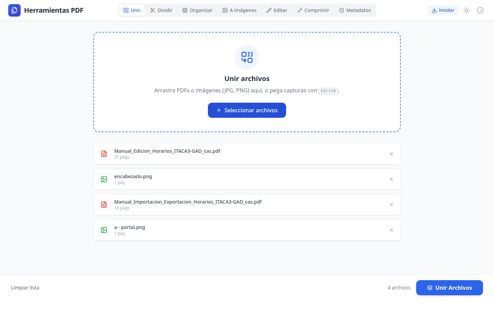
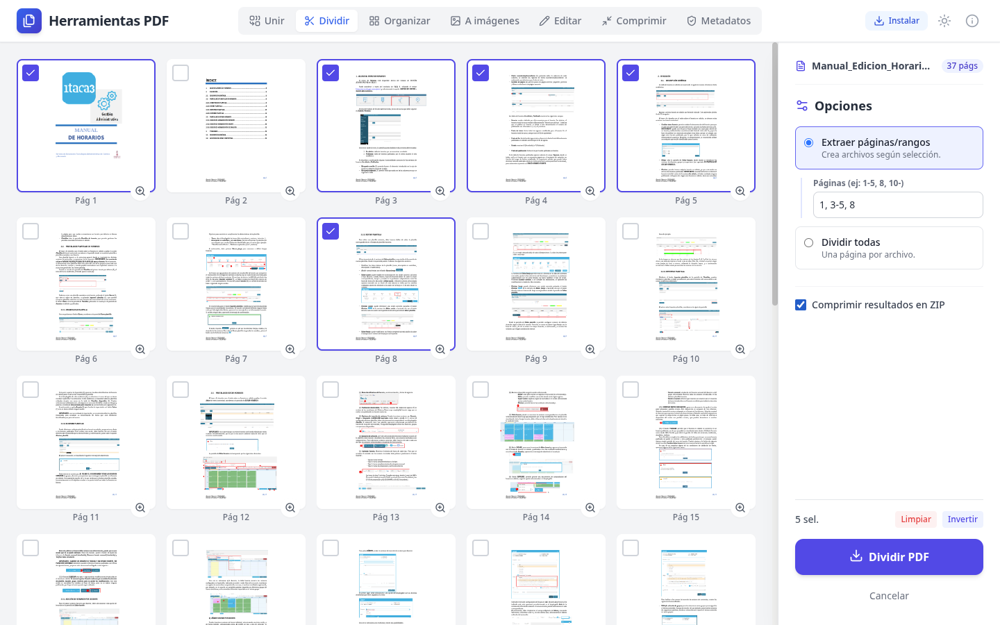
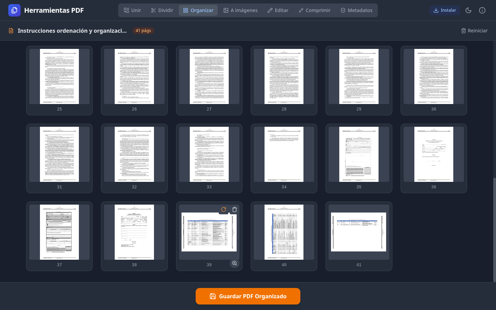
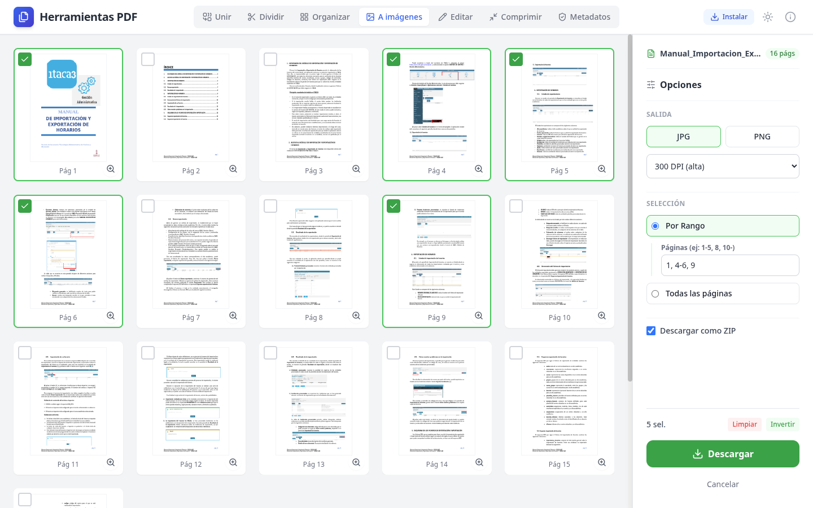
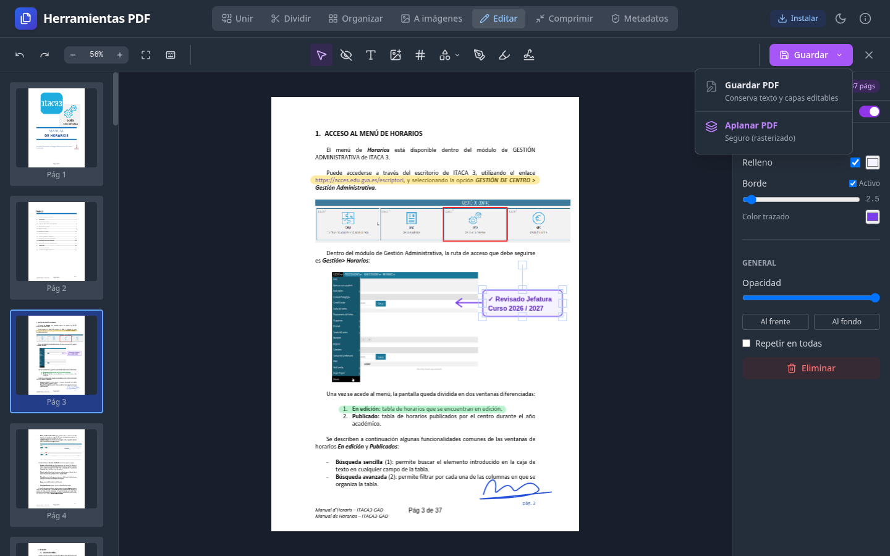
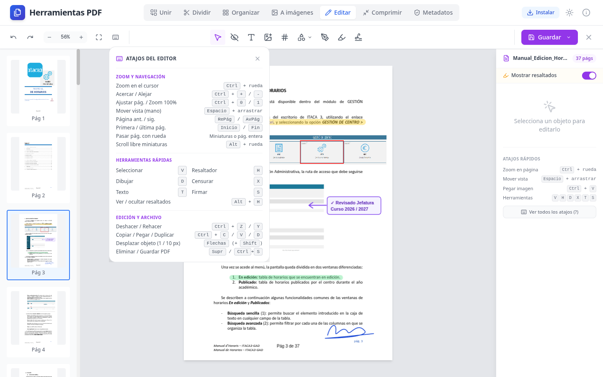
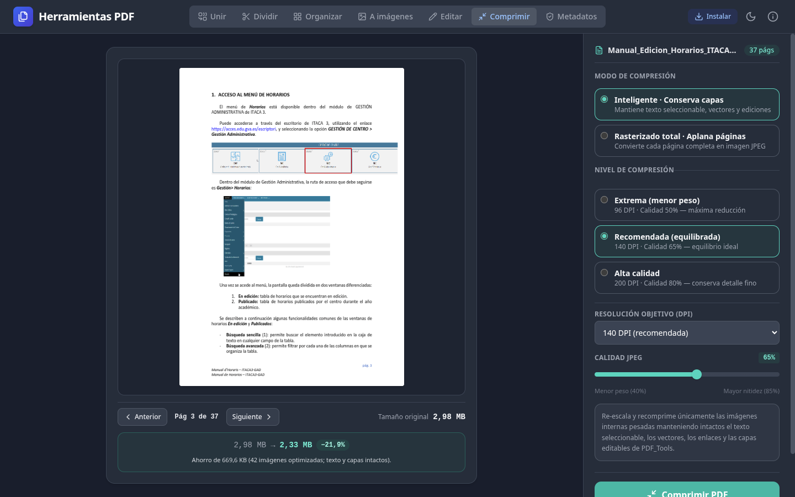
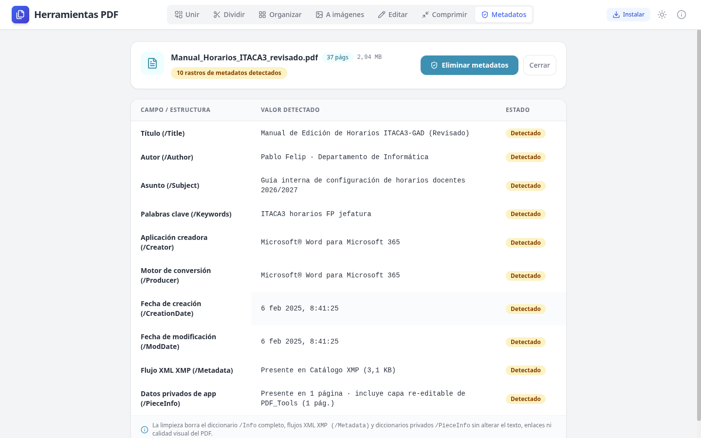

# PDF Tools (SPA)

**Una suite completa de herramientas PDF privada, instalable (PWA) y 100 % local en tu navegador.**

### 🌐 Accede a la aplicación aquí: [pdftools.pablofelip.online](https://pdftools.pablofelip.online)

> Esta aplicación es la evolución web (Single Page Application / PWA) de la extensión para Chrome **[PDF Tools](https://github.com/pfelipm/pdf-tools)**.

## 🚀 Demo

## 📖 Descripción

**PDF Tools (SPA)** es una aplicación web progresiva diseñada para manipular archivos PDF con **privacidad absoluta**. A diferencia de los servicios online tradicionales, procesa todos tus documentos íntegramente en la memoria de tu dispositivo mediante APIs web modernas (Canvas 2D, Web Streams, Service Workers), garantizando que **tus archivos nunca se suben a ningún servidor**.

Su interfaz de escritorio aprovecha toda la ventana del navegador para ofrecer **7 herramientas interconectadas**, arrastrar y soltar (*drag & drop*) universal, pegado directo desde el portapapeles (`Ctrl+V`), previsualizaciones de alta definición y funcionamiento completo **sin conexión a Internet** tras la primera visita.

## ✨ Características Principales

*   **Unir PDF e imágenes:** Combina múltiples archivos PDF e imágenes (incluyendo recortes o capturas pegadas directamente con `Ctrl+V`) en un único documento, reordenándolos visualmente antes de fusionar.
*   **Dividir PDF:** Extrae rangos de páginas personalizados o separa un documento en archivos individuales con renderizado perezoso (*lazy rendering*) optimizado para PDFs extensos.
*   **Organizar PDF:** Vista interactiva tipo «mesa de luz» para reordenar, rotar, duplicar o eliminar páginas sobre cualquier PDF existente.
*   **A imágenes:** Convierte las páginas de un PDF a formatos **JPG** o **PNG** de alta calidad, con descarga individual o empaquetada en **ZIP**.
*   **Editor visual PDF con capas re-editables:**
    *   **Anotación y maquetación rica:** superpone cuadros de texto, imágenes (desde archivo o portapapeles `Ctrl+V`), formas geométricas (rectángulos, círculos, flechas, líneas, estrellas), dibujo a mano alzada, **marcador fluorescente** (con interruptor global para mostrar u ocultar todos los resaltados de golpe), **firma / rúbrica manuscrita** (trazo caligráfico o subida de foto en papel con eliminación automática del fondo blanco y guardado opcional en el navegador), **numeración dinámica de páginas** y **pixelado** para censura.
    *   **Guardado re-editable:** exporta manteniendo el texto seleccionable original e incrustando de forma transparente los objetos de edición en el propio PDF (`/PieceInfo`), de modo que **al reabrir el archivo en PDF Tools puedes volver a mover, modificar o borrar cualquier texto, figura, firma o resaltado** (incluso después de unir, dividir o rotar páginas).
    *   **Aplanado seguro:** alternativa de exportación que rasteriza cada página componiendo también formularios y sellos visuales de firmas digitales (`/Annots`) para garantizar que la información censurada sea irrecuperable.
    *   **Ergonomía ágil:** miniaturas laterales actualizadas en vivo, zoom anclado al puntero (`Ctrl + rueda`), desplazamiento libre (`Espacio + arrastrar`), cambio rápido de página con rueda y panel integrado de atajos de teclado (`?`).
*   **Comprimir PDF (2 modos):**
    *   **Inteligente · Conserva capas:** analiza y recomprime selectivamente solo las imágenes internas pesadas manteniendo intactos el texto seleccionable, los vectores, los enlaces y las capas editables de PDF Tools.
    *   **Rasterizado total · Aplana páginas:** convierte cada página a imagen JPEG respetando sus dimensiones físicas exactas, ideal para aligerar drásticamente documentos escaneados o aplanar y comprimir en un solo paso.
    *   Incorpora visor multipágina nítido, preajustes rápidos (*Extrema*, *Recomendada*, *Alta calidad*), control fino de resolución (`72–200 DPI`) y calidad JPEG (`40–85 %`) con comparativa real del ahorro conseguido.
*   **Inspector y Limpiador de Metadatos:** Audita los campos estándar y personalizados del diccionario `/Info`, flujos XML `XMP (/Metadata)` y bloques privados `/PieceInfo`, permitiendo purgarlos por completo antes de compartir o publicar un PDF sin alterar su aspecto visual.
*   **Flujo continuo («Enviar a…»):** Encadena el resultado de cualquier operación directamente hacia otra herramienta (por ejemplo: *Unir → Editar → Comprimir → Metadatos*) sin necesidad de descargar ni volver a abrir archivos intermedios.
*   **PWA instalable, 100 % Offline y Modo Oscuro:** Puede instalarse como aplicación independiente en escritorio o móvil, funciona sin conexión tras la primera carga (con aviso discreto cuando se publica una actualización) e incluye modo claro/oscuro sincronizado con el sistema.

## 🆚 SPA (PWA) vs Extensión de Chrome

Ambas ediciones comparten el mismo principio de privacidad local, adaptándose a distintos flujos de trabajo:

| Característica | Versión SPA / PWA (Web) | Versión Extensión Chrome |
| :--- | :--- | :--- |
| **Acceso** | Desde cualquier navegador moderno vía URL o **instalable como app (PWA)**. | Instalación desde Chrome Web Store en navegadores Chromium. |
| **Conectividad** | **100 % Offline tras la primera visita** (caché mediante *Service Worker*). | **100 % Offline** desde el momento de la instalación. |
| **Interfaz** | Espacio completo de escritorio con 7 herramientas, editor ampliado y previsualizaciones grandes. | Panel lateral compacto (*SidePanel*) integrado junto a la pestaña activa. |
| **Privacidad** | ✅ **Privacidad Total** (procesamiento 100 % local). | ✅ **Privacidad Total** (procesamiento 100 % local). |
| **Actualizaciones** | Automáticas desde la web con notificación integrada de nueva versión. | Gestionadas automáticamente por Chrome Web Store. |

**En resumen:** si buscas un panel rápido siempre a mano junto a otras webs en Chrome, usa la **[Extensión](https://github.com/pfelipm/pdf-tools)**. Si prefieres el conjunto completo de 7 herramientas a pantalla completa en cualquier navegador o como aplicación instalada, usa esta **SPA / PWA**.

## 📸 Capturas de Pantalla

### Unir PDFs e imágenes (y pegado con `Ctrl+V`)

### Dividir PDF y extraer rangos personalizados

### Organizar y enderezar páginas (modo oscuro)

### Exportar páginas como imágenes de alta resolución

### Editor visual: resaltadores, rúbrica, miniaturas en vivo y guardado re-editable

### Editor visual: gestos y panel de atajos de teclado

### Comprimir PDF conservando texto y capas (o mediante rasterizado)

### Inspector y limpiador de metadatos (`/Info`, `XMP` y `/PieceInfo`)

## 🛠️ Tecnologías

*   **HTML5 / JavaScript (ES6+):** Arquitectura *Single-File SPA* en Vanilla JS sin *frameworks* ni pasos de compilación, utilizando elementos nativos modernos (`<dialog>`, `Popover API`, `CompressionStream` / `DecompressionStream`).
*   **PWA & Seguridad:** `Web App Manifest`, `Service Worker` con estrategia *Cache-First* offline y verificación criptográfica *Subresource Integrity* (`SRI`) en dependencias externas.
*   **Tailwind CSS (`3.4.17`):** Diseño responsivo, adaptable a contenedores y con soporte de modo oscuro.
*   **PDF.js (`3.11.174`):** Renderizado de páginas en alta densidad de píxeles y generación perezosa de miniaturas.
*   **pdf-lib (`1.17.1`):** Manipulación estructural de documentos PDF, optimización selectiva de flujos de imagen, gestión de capas `/PieceInfo` y limpieza de metadatos.
*   **Fabric.js (`5.3.1`):** Lienzo vectorial interactivo del editor visual, trazos a mano alzada, resaltadores, rúbricas y serialización de objetos re-editables.
*   **JSZip (`3.10.1`):** Empaquetado local en archivos `.zip` para descargas múltiples.
*   **Sortable.js (`1.15.0`):** Reordenación fluida mediante arrastrar y soltar.
*   **Lucide (`0.469.0`):** Sistema de iconografía vectorial.

## 👥 Créditos

Este proyecto ha sido creado y es mantenido por **[Pablo Felip](https://www.linkedin.com/in/pfelipm/)**.

## 📄 Licencia

Este proyecto está distribuido bajo la licencia **GNU AGPL v3.0**. Consulta el archivo **[LICENSE](LICENSE)** para más detalles.
